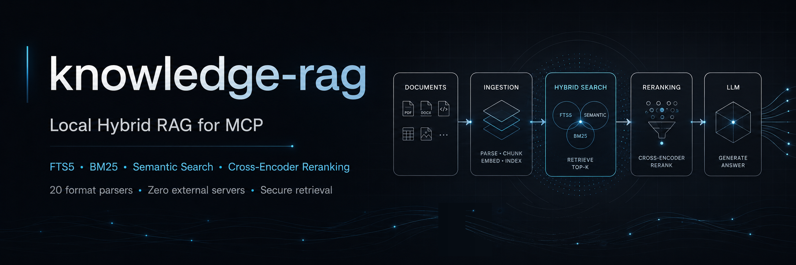
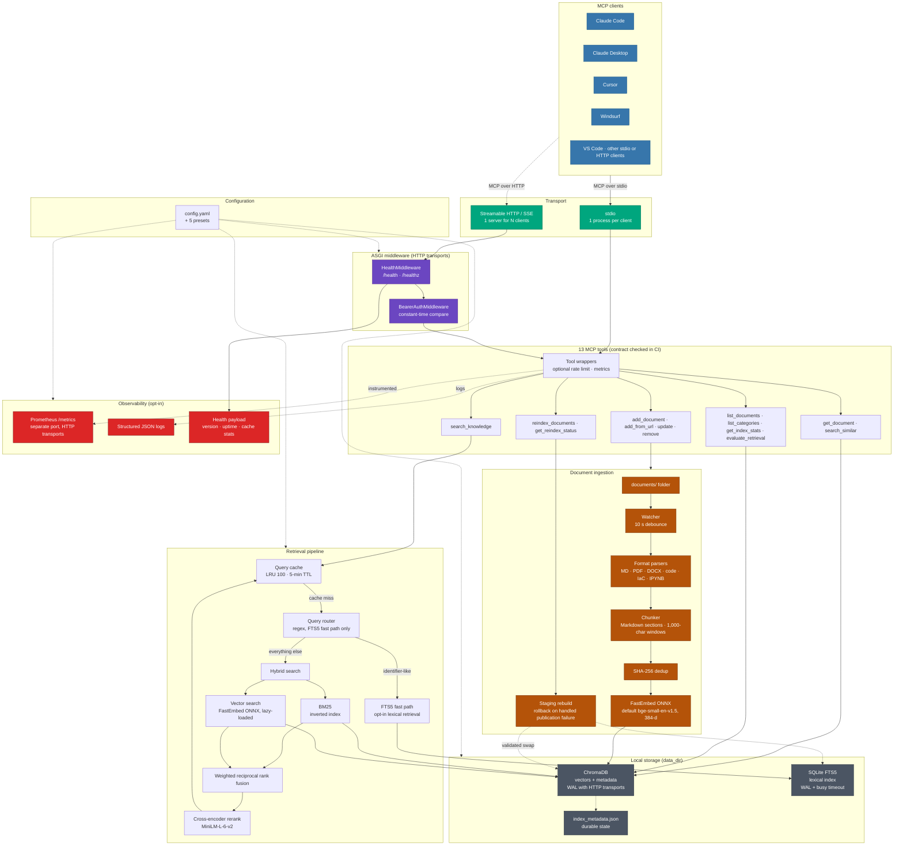

<p align="center">
  
</p>

# knowledge-rag: local RAG server for Claude Code, Cursor and other MCP clients

**knowledge-rag** is a local retrieval-augmented generation (RAG) server for the Model Context Protocol (MCP). It indexes the documents and code on your machine and gives Claude Code, Cursor, VS Code and other MCP clients 13 tools to search them, using hybrid search (BM25 keywords plus vector similarity) with cross-encoder reranking on by default. Everything runs in one Python process with embedded ChromaDB and FastEmbed ONNX models: no Docker, no database server, no API key. Indexing and search work offline once the models are cached.

<div align="center">

[](https://pypi.org/project/knowledge-rag/)
[](https://www.npmjs.com/package/knowledge-rag)
[](https://pepy.tech/projects/knowledge-rag)


[](https://github.com/lyonzin/knowledge-rag/actions/workflows/security.yml)
[](https://github.com/lyonzin/knowledge-rag/actions/workflows/quality-gate.yml)
[](https://glama.ai/mcp/servers/lyonzin/knowledge-rag)
[](https://bestpractices.coreinfrastructure.org/projects/13864)
</div>

- **11.1 ms** median uncached hybrid query on CPU, **6.1 ms** on CUDA: 36 queries over 149 chunks on one Windows host, reranker off ([audit](docs/audit-2026-10-03.md#real-cpu-and-nvidia-workload))
- **0.03 ms** median for a repeated query served from the cache, same workload ([audit](docs/audit-2026-10-03.md#real-cpu-and-nvidia-workload))
- **75,016 chunks** from 5,889 documents: full rebuild completed in a production reproduction ([v4.8.3](CHANGELOG.md#v483-2026-08-10--critical-hotfix-nuclear-rebuild--smart-reindex-hardening))
- **1,500+ tests** collected on each of 9 OS × Python CI cells (platform-specific ones skip), 84% line coverage against an 80% floor ([CI run, 2026-11-06](https://github.com/lyonzin/knowledge-rag/actions/runs/42145409731))

Install and register with Claude Code (needs Python 3.11+ and Node.js 16+):

```bash
npx -y knowledge-rag --install-only
claude mcp add knowledge-rag -s user --env KNOWLEDGE_RAG_DIR=~/knowledge-rag -- npx -y knowledge-rag
```

Put files in `~/knowledge-rag/documents/` and ask your agent to search them. The folder is created on first start, new and changed files are indexed automatically, and the models (about 150 MB) download the first time they are needed.

[Install](#install) · [Results](#measured-results) · [How it works](#how-it-works) · [Tools](#the-13-mcp-tools) · [Skills](#agent-skills) · [Comparison](#how-knowledge-rag-compares-to-other-rag-projects) · [FAQ](#faq) · [Docs](#documentation)

## Star history

<p align="center">
  <a href="https://www.star-history.com/?repos=lyonzin%2Fknowledge-rag&type=date&legend=top-left">
    
  </a>
</p>

<p align="center"><sub>Updated daily by the <a href="./.github/workflows/update-star-history.yml">star-history workflow</a>.</sub></p>

## Measured results

Measurements from the project's own audits. They come from one host and small corpora, so treat them as orders of magnitude for your planning, not as guarantees.

| Measurement | CPU | NVIDIA CUDA |
| --- | ---: | ---: |
| Hybrid query, uncached, median | 11.13 ms | 6.10 ms |
| Hybrid query, uncached, p95 | 13.91 ms | 7.44 ms |
| Repeated query (cache hit), median | 0.033 ms | 0.028 ms |
| Initial indexing, including first model load | 13.655 s | 0.832 s |
| Sampled peak process memory (RSS) | 1,416 MB | 990 MB |

Workload: `scripts/audit_retrieval.py` indexing 7 public repository documents (149 chunks) into a temporary ChromaDB and FTS5 index; 36 uncached queries; cross-encoder disabled to isolate retrieval; Windows 11, RTX 3080 Ti, Python 3.12.7, FastEmbed 0.8.1, ChromaDB 1.5.9, model `BAAI/bge-small-en-v1.5`, Hugging Face offline mode. Source: [audit 2026-10-03](docs/audit-2026-10-03.md#real-cpu-and-nvidia-workload).

| Retrieval check | Result | Workload and source |
| --- | --- | --- |
| Expected source in the top 5 | 12 of 12 questions; MRR@5 0.875 (English), 0.792 (Portuguese) | 6 English and 6 Portuguese questions over the same 149 chunks, default English model; a small smoke test, not a general quality claim ([audit](docs/audit-2026-10-03.md#real-cpu-and-nvidia-workload)) |
| Cross-encoder rerank of 8 candidates | 141.9 ms first call including model load, 19.7 ms next call (CPU) | One English and one Portuguese query, network blocked ([audit](docs/audit-2026-10-03.md#real-cpu-and-nvidia-workload)) |
| Large corpus | Full rebuild completed and filled 75,016 FTS5 rows on the first attempt | 5,889 documents / 75,016 chunks, v4.8.3 reproduction ([CHANGELOG](CHANGELOG.md#v483-2026-08-10--critical-hotfix-nuclear-rebuild--smart-reindex-hardening)) |

<details>
<summary>More measurements: memory, model comparison, historical baseline</summary>

- **BM25 memory:** retained Python memory fell from 120.7 MB to 26.9 MB (−77.75%) for 10,000 documents / 1.99 million tokens after the token pool was added in v4.10.0 ([audit](docs/audit-2026-10-03.md#memorystorage-measurements)).
- **Metrics memory:** 100,001 metric observations retained 328 bytes instead of 3,201,024 ([audit](docs/audit-2026-10-03.md#memorystorage-measurements)).
- **Multilingual model:** on a 60-question diagnostic set over a private ~70,000-chunk corpus, `intfloat/multilingual-e5-large` found the expected source for 36 questions against 37 for the default `BAAI/bge-small-en-v1.5`; re-embedding 70,083 chunks on CUDA took 1,186.58 s ([audit 2026-10-04](docs/audit-2026-10-04.md#multilingual-model-comparison)).
- **Historical baseline:** v4.7.1 microbenchmarks and a 100-document rebuild on CPU ([perf-baseline-v4.7.1](docs/perf-baseline-v4.7.1.md)). The ratios apply to those workloads only.
- **Live dashboard:** the [benchmark dashboard](https://lyonzin.github.io/knowledge-rag/) tracks CI microbenchmarks. They use mocked storage and models, so they answer a different question than the real-model numbers above.

</details>

## How it works

1. **Ingest.** Files under `documents/` are parsed by format: code files get their function, class and import names as metadata, notebooks keep only Markdown and code cells, PDFs contribute their text. Markdown is split at `##`/`###` sections; every other format is cut into 1,000-character chunks with 200 characters of overlap. Chunks are de-duplicated by SHA-256, embedded with FastEmbed (default `BAAI/bge-small-en-v1.5`, 384 dimensions) and stored in an embedded ChromaDB.
2. **Watch.** While the server runs, a watcher re-indexes changed files after 10 seconds without new changes. Full rebuilds fill a staging collection and swap it in after validation, so searches keep using the current index.
3. **Search.** `search_knowledge` checks a query cache (100 entries, 5-minute TTL), runs BM25 over an inverted index and vector search, fuses both rankings with weighted reciprocal rank fusion (`hybrid_alpha`, default 0.3, leaning towards keywords) and reranks the top candidates with the `Xenova/ms-marco-MiniLM-L-6-v2` cross-encoder. With the opt-in FTS5 fast path, identifier-like queries such as CVE IDs, ticket keys and hashes go to SQLite FTS5 first.
4. **Answer.** Results go back to the MCP client with the file path, chunk index, snippet and scores. The client's model writes the answer; knowledge-rag never calls an LLM.
5. **Serve.** Over stdio for one client, or as one Streamable HTTP or SSE server for many. HTTP mode answers health probes first, then checks the bearer token. Every tool call passes through the optional rate limiter and metrics. `config.yaml` and five presets configure all of it.



Component ownership, memory and concurrency boundaries and the `hybrid_alpha` weights: [docs/ARCHITECTURE.md](docs/ARCHITECTURE.md).

## Install

Every path below runs the same server. Each `claude mcp add` sets `KNOWLEDGE_RAG_DIR`, the folder that holds `config.yaml`, `documents/`, `data/` and `models_cache/`. Without it, the server picks a folder from its install location and the working directory the client starts it in, which can be a project you did not intend ([`config.py`](mcp_server/config.py)).

### Claude Code with the npx launcher

```bash
npx -y knowledge-rag --install-only
claude mcp add knowledge-rag -s user --env KNOWLEDGE_RAG_DIR=~/knowledge-rag -- npx -y knowledge-rag
```

The npm package is a launcher. It finds Python 3.11+ (`python3`/`python`, or `python`/`py -3` on Windows), creates a virtual environment in `~/.knowledge-rag/venv`, installs the matching `knowledge-rag` version from PyPI and starts the server over stdio. `--install-only` does the installation once ahead of time, so the client's first start does not wait for pip. A new npm version reinstalls the package on the next start. If a client on native Windows fails to start `npx`, register `cmd /c npx -y knowledge-rag` instead.

### pip in a virtual environment

```bash
python3 -m venv ~/knowledge-rag/venv
~/knowledge-rag/venv/bin/python -m pip install knowledge-rag
claude mcp add knowledge-rag -s user --env KNOWLEDGE_RAG_DIR=~/knowledge-rag \
  -- ~/knowledge-rag/venv/bin/python -m mcp_server.server
```

On Windows (PowerShell), use `python` and `$HOME\knowledge-rag\venv\Scripts\python.exe` in place of `python3` and `~/knowledge-rag/venv/bin/python`.

Optional: `knowledge-rag init`, run inside `~/knowledge-rag` with the virtual environment active, copies `config.example.yaml` and the five presets and creates `documents/`. It does not create `config.yaml` or register the server: copy the template or a preset to `config.yaml` yourself. Without a `config.yaml`, the defaults apply, including all 33 default file types.

### Docker

The image is published for `linux/amd64` and `linux/arm64`. For stdio, the client starts one container per session:

```bash
claude mcp add knowledge-rag -s user -- docker run -i --rm \
  -v ~/knowledge-rag/documents:/app/documents \
  -v ~/knowledge-rag/data:/app/data \
  -v knowledge-rag-models:/app/models_cache \
  ghcr.io/lyonzin/knowledge-rag:latest
```

The image runs `python -m mcp_server.server`, which reads `/app/config.yaml` and defaults to stdio on `127.0.0.1`. To serve HTTP from a container, mount a config that listens on all container interfaces and pass `--transport`:

```bash
mkdir -p ~/knowledge-rag
cat > ~/knowledge-rag/config.yaml <<'EOF'
server:
  host: "0.0.0.0"
  auth:
    bearer_token: "replace-with-a-long-random-token"
EOF
docker run -d --name knowledge-rag -p 127.0.0.1:8179:8179 \
  -v ~/knowledge-rag/config.yaml:/app/config.yaml:ro \
  -v ~/knowledge-rag/documents:/app/documents \
  -v ~/knowledge-rag/data:/app/data \
  -v knowledge-rag-models:/app/models_cache \
  ghcr.io/lyonzin/knowledge-rag:latest --transport streamable-http
curl http://127.0.0.1:8179/health
claude mcp add --transport http knowledge-rag http://127.0.0.1:8179/mcp \
  # if server.auth.bearer_token is set, add the token as a Bearer auth header
```

The image builds its model copies into FastEmbed's default cache, but the server reads `/app/models_cache`, so the models download again the first time they are needed. The `knowledge-rag-models` volume keeps them across containers.

### Shared HTTP server for several clients

`stdio` fits one client that owns one process. For several clients on one index (Claude Code, Cursor, LM Studio, more terminals), run one Streamable HTTP server and point every client at it ([#217](https://github.com/lyonzin/knowledge-rag/pull/217), [#223](https://github.com/lyonzin/knowledge-rag/issues/223)):

```yaml
# ~/knowledge-rag/config.yaml
server:
  transport: "streamable-http"      # "sse" for clients that only speak SSE
  host: "127.0.0.1"
  port: 8179
  auth:
    bearer_token: "replace-with-a-long-random-token"
  rate_limit:
    enabled: true
    requests_per_minute: 60
    burst: 10
  metrics:
    enabled: true
    port: 9179                      # binds 0.0.0.0 with no auth: firewall it
  logging:
    format: "json"
```

```bash
KNOWLEDGE_RAG_DIR=~/knowledge-rag knowledge-rag     # run from the venv where you installed it
curl http://127.0.0.1:8179/health                  # {"status":"ok","version":"5.0.0",...}
claude mcp add --transport http knowledge-rag http://127.0.0.1:8179/mcp \
  # if server.auth.bearer_token is set, add the token as a Bearer auth header
```

| Transport | Clients per server process | Who runs the process | Use it for |
| --- | --- | --- | --- |
| `stdio` (default) | 1 | The MCP client, per session | One client; models load in each process on first use |
| `streamable-http` | Many | You, one background server | Several clients sharing one index and one model load (preferred) |
| `sse` | Many | You, one background server | HTTP clients that only support SSE |

HTTP transports switch on the single-instance lock (`KNOWLEDGE_RAG_SINGLE_INSTANCE=1`), so a second server cannot open the same data directory. The default host is `127.0.0.1`. If you bind to `0.0.0.0` or serve a network, set `server.auth.bearer_token` and put TLS in front with a reverse proxy such as Caddy or Nginx; without a token, the server prints a warning that the endpoint is unauthenticated.

<details>
<summary>Claude custom connectors (remote MCP)</summary>

- **Network requirement:** custom connector requests come from Anthropic's cloud on web, desktop and mobile, so they cannot reach `127.0.0.1`. Expose the server through a secure public HTTPS endpoint (for example Cloudflare Tunnel, ngrok or a reverse proxy) at `https://your-public-domain/mcp`. Configure the proxy to send an upstream `Host` that the HTTP app accepts for `server.host` (with the default loopback configuration, `127.0.0.1:8179`); forwarding the public hostname unchanged can produce `421 Invalid Host header`. Keep bearer authentication and HTTPS on. A local `claude_desktop_config.json` uses `command`/`args` for local stdio processes and does not support remote HTTP endpoints.
- **Setup and auth:** in Claude (Pro/Max: **Customize > Connectors > + Add > Add custom connector**; Team/Enterprise owners: **Organization settings > Connectors**), enter the public endpoint. Under **Request headers**, set `Authorization` to `Bearer <your-token>`, matching `server.auth.bearer_token` in `config.yaml`. See Anthropic's [custom connectors guide](https://support.claude.com/en/articles/11175166-get-started-with-custom-connectors-using-remote-mcp).

</details>

### Other MCP clients

Any client that starts a stdio MCP server from a command, or connects to a Streamable HTTP endpoint, can use knowledge-rag. The [installation guide](docs/INSTALLATION.md#use-with-other-mcp-clients) has the exact JSON for each of these:

| Client | Where the server entry goes |
| --- | --- |
| Claude Desktop | `claude_desktop_config.json`, under `mcpServers` (Settings → Developer → Edit Config) |
| Cursor | `~/.cursor/mcp.json` or `.cursor/mcp.json`, under `mcpServers` |
| Windsurf | `~/.codeium/windsurf/mcp_config.json`, under `mcpServers` |
| Antigravity | `~/.gemini/antigravity/mcp_config.json`, under `mcpServers` |
| VS Code (Copilot) | `.vscode/mcp.json`, under `servers`, with `"type": "stdio"` |
| opencode | `opencode.json`, under `mcp`, with `command` as an array |

```json
{
  "mcpServers": {
    "knowledge-rag": {
      "command": "npx",
      "args": ["-y", "knowledge-rag"],
      "env": { "KNOWLEDGE_RAG_DIR": "~/knowledge-rag" }
    }
  }
}
```

> [!WARNING]
> **One writer per data directory.** Over stdio, each MCP client starts and owns its own knowledge-rag process. Do not run a second writer against the same `data_dir` while that client is open: on Windows, two writers corrupted the ChromaDB HNSW segment ([#216](https://github.com/lyonzin/knowledge-rag/issues/216)). Add `"KNOWLEDGE_RAG_SINGLE_INSTANCE": "1"` to the client's `env` block as a safety net, or share one HTTP server. Running CLI commands safely: [docs/single-instance.md](docs/single-instance.md).

> [!WARNING]
> **Keep `data_dir` out of cloud-sync folders.** OneDrive (including `OneDrive - <tenant>`), iCloud Drive, Dropbox, Google Drive, Box, pCloud, MEGAsync, Nextcloud/ownCloud and Sync hold handles on the live index while they upload it. That races with ChromaDB's HNSW memory maps and SQLite WAL writes and can crash the process (`0xC0000005` on Windows, `SIGBUS` elsewhere); startup auto-repair then moves the index to `data/backups/auto-repair-*` and you reindex from scratch. Since v4.11.0, startup stops with exit code 78 (`EX_CONFIG`) when `data_dir` resolves under one of these providers. Use a local path such as `%LOCALAPPDATA%\knowledge-rag\data` on Windows or `~/.local/share/knowledge-rag/data` on Linux and macOS, or set `paths.allow_cloud_sync: true` to accept the risk.

All install methods, GPU setup and troubleshooting for each client: [docs/INSTALLATION.md](docs/INSTALLATION.md).

## The 13 MCP tools

| Tool | What it does |
| --- | --- |
| `search_knowledge` | Hybrid BM25 + vector search with cross-encoder reranking; filters by category, folders (`include_folders`, `exclude_folders`) and `min_score` |
| `get_document` | Returns the full content of one indexed file |
| `search_similar` | Finds documents similar to an indexed file |
| `evaluate_retrieval` | Reports MRR@5 and Recall@5 for your own query → expected file pairs |
| `list_documents` | Lists indexed documents, 100 per page by default (up to 200 with `limit`), paged with `offset` |
| `list_categories` | Lists categories, derived from folder paths, with document counts |
| `get_index_stats` | Document and chunk counts, embedding model, BM25 status, cache hit rate, watcher status, HNSW self-recall probe |
| `add_document` | Saves text as a file under `documents/` and indexes it |
| `update_document` | Replaces a document's content and re-indexes it |
| `remove_document` | Removes a document's chunks from the index, and optionally the file |
| `add_from_url` | Fetches an http(s) page, strips the HTML, saves it as Markdown with a provenance marker and indexes it |
| `reindex_documents` | Incremental by default; `force` re-embeds every file, `full_rebuild` builds and swaps a staging collection; runs in the background |
| `get_reindex_status` | Reports the progress of a background reindex |

Each result carries `source` (the file path), `chunk_index` and, in snippet mode, `match_offset` (a character offset into the content), so citations point to a file and chunk, not a line number. `score` is normalized per query, so the top result is always 1.0 and `min_score` filters relative to the other results; compare `reranker_score`, the raw cross-encoder score, across queries. Parameters, return shapes and examples: [docs/API.md](docs/API.md).

## Agent skills

The 13 tools tell an agent what it can do; they do not tell it when to search. The [`skills/`](skills/) folder adds ten MIT-licensed skills for Claude Code that make the agent check your index first, cite what it used and keep the index current. Other agents can use the same instructions as rules or system prompts ([skills/README.md](skills/README.md)).

| Skill | Kind | What it changes |
| --- | --- | --- |
| [`rag-check-first`](skills/foundation/rag-check-first/SKILL.md) | Foundation | Searches the corpus before answering technical questions |
| [`rag-cite-sources`](skills/foundation/rag-cite-sources/SKILL.md) | Foundation | Cites the source file and chunk for every claim taken from the corpus |
| [`rag-onboard-context`](skills/foundation/rag-onboard-context/SKILL.md) | Foundation | Probes what is indexed at the start of a session |
| [`rag-deep-dive`](skills/workflow/rag-deep-dive/SKILL.md) | Workflow | Search, read the best document in full, then find similar ones |
| [`rag-web-fallback`](skills/workflow/rag-web-fallback/SKILL.md) | Workflow | Goes to the web only when the local corpus comes back empty or insufficient |
| [`rag-troubleshoot`](skills/workflow/rag-troubleshoot/SKILL.md) | Workflow | Looks up prior fixes and runbooks before debugging an error |
| [`rag-code-review`](skills/workflow/rag-code-review/SKILL.md) | Workflow | Checks ADRs, standards and similar files before commenting on a change |
| [`rag-index-decisions`](skills/maintenance/rag-index-decisions/SKILL.md) | Maintenance | Indexes decisions and fixes back into the corpus |
| [`rag-evaluate-quality`](skills/maintenance/rag-evaluate-quality/SKILL.md) | Maintenance | Measures MRR@5 and Recall@5 after ingestion or configuration changes |
| [`rag-security-first`](skills/domain/rag-security-first/SKILL.md) | Domain | Consults MITRE ATT&CK, CVE and runbook notes first on security tasks |

Each skill installs as `~/.claude/skills/<skill-name>/SKILL.md` (or `.claude/skills/<skill-name>/SKILL.md` for one project):

```bash
# Node.js 22.20+: choose the skills and agents interactively; -g installs for all projects
npx skills add lyonzin/knowledge-rag -g

# Without Node (Linux, macOS, WSL, Git Bash): all ten skills into ~/.claude/skills
curl -fsSL https://raw.githubusercontent.com/lyonzin/knowledge-rag/master/skills/install.sh | bash
```

`install.sh` also takes `--project`, `--target <path>`, `--only rag-check-first,rag-cite-sources`, `--dry-run`, `--list` and `--help`. Restart Claude Code after installing. Skill chains and per-client setup: [skills/CATALOG.md](skills/CATALOG.md), [skills/README.md](skills/README.md).

## How knowledge-rag compares to other RAG projects

As of 2026-11-06. 🗸 default: built in and on by default. 🗸 opt-in: built in, off until you enable it. 🗸: available, default state not compared. component: a library piece you assemble yourself. ✗: not built in, meaning absent from the code, needing an external provider (local embeddings column), or not found in code or docs; ✗ manual: you start it yourself. Words in parentheses name the mechanism.

| Project (stars, license) | MCP server | MCP client | Hybrid | Rerank | Auto re-index | Local emb. |
| --- | --- | --- | --- | --- | --- | --- |
| **knowledge-rag (301, MIT)** | 🗸 13 tools | ✗ | 🗸 default (+FTS5 opt-in) | 🗸 default | 🗸 default | 🗸 |
| Dify (160.5k, Dify license) | 🗸 | 🗸 | 🗸 | 🗸 opt-in | ✗ manual sync | ✗ |
| Open WebUI (157.9k, Open WebUI license) | ✗ | 🗸 | 🗸 opt-in | 🗸 opt-in | ✗ manual (add-on) | 🗸 |
| Langflow (156.4k, MIT) | 🗸 | 🗸 | component | component | component (Schedule Trigger) | component |
| LangChain (149.1k, MIT) | ✗ | 🗸 | component | component | component (indexing API) | component |
| RAGFlow (93.7k, Apache-2.0) | 🗸 | 🗸 | 🗸 default | 🗸 opt-in | 🗸 connectors | ✗ |
| AnythingLLM (68.0k, MIT) | ✗ | 🗸 | ✗ | 🗸 opt-in | 🗸 opt-in (beta, per file, hourly) | 🗸 |
| Serviette, ex pathwaycom/llm-app (58.7k, MIT) | ✗ | ✗ | 🗸 opt-in | 🗸 opt-in | 🗸 default | 🗸 |
| PrivateGPT (57.6k, Apache-2.0) | ✗ | 🗸 | 🗸 opt-in (Qdrant) | ✗ | 🗸 opt-in (CLI --watch) | ✗ |
| LlamaIndex (52.8k, MIT) | ✗ | 🗸 | component | component | component (refresh_ref_docs) | ✗ |
| LightRAG (40.6k, MIT) | ✗ | ✗ | ✗ | 🗸 opt-in (API) | ✗ manual scan | ✗ |
| Quivr 2 (39.6k, MIT) | 🗸 | ✗ | 🗸 | 🗸 opt-in (paid service) | 🗸 scheduled feeds | 🗸 |
| Khoj (38.0k, AGPL-3.0) | ✗ | 🗸 | ✗ | 🗸 opt-in | 🗸 via clients, every 10 min | 🗸 |
| GraphRAG (36.6k, MIT) | ✗ | ✗ | ✗ | ✗ | ✗ manual (graphrag update) | ✗ |
| Onyx (33.3k, MIT CE + EE) | 🗸 | 🗸 | 🗸 default | ✗ removed in 2026 | 🗸 connectors | 🗸 |
| FastGPT (30,000, FastGPT license) | 🗸 | 🗸 | 🗸 | 🗸 with a rerank model | 🗸 opt-in (daily sync) | ✗ |

| Project | Type | Needs for first answer | Formats |
| --- | --- | --- | --- |
| **knowledge-rag** | MCP server | pip + MCP client | 33 (+2 opt-in), code/IaC; no OCR |
| Dify | platform | Docker (Postgres, Redis, Weaviate…) + model | PDF, Office, CSV, MD, HTML, EML, EPUB |
| Open WebUI | chat app | pip/Docker + Ollama/API | PDF, Office, EPUB, CSV, HTML, MD |
| Langflow | builder | pip/Docker + provider key | TXT, MD, CSV, JSON, HTML, PDF, DOCX… |
| LangChain | library | code + provider | loaders |
| RAGFlow | engine + UI | Docker (Elasticsearch, MySQL, MinIO, Kvrocks, NATS), 16 GB + model | Office, PDF, scans, web |
| AnythingLLM | desktop/Docker app | installer (built-in LLM) | PDF, TXT, DOCX… |
| Serviette | RAG server | pip + Pathway licence key | text, Office, PDF, scans |
| PrivateGPT | API server | LLM + embedding servers | PDF, DOCX, PPT/X, EPUB, IPYNB, images, audio |
| LlamaIndex | library | code + OPENAI_API_KEY | ~20 incl. images, MP3/4 |
| LightRAG | graph lib + server | LLM + embedding providers | TXT, MD, PDF, DOCX |
| Quivr 2 | HTTP engine | Docker (Postgres, object store) | PDF plugin, RSS, mail |
| Khoj | app | Docker (pgvector, SearxNG…) + LLM | PDF, MD, Org, Word, Notion |
| GraphRAG | library/CLI | OpenAI/Azure key | TXT, CSV, JSON |
| Onyx | enterprise app | Docker (~12 containers: OpenSearch, Postgres, Redis…) + LLM | PDF, DOCX, PPTX, XLSX, EML, EPUB, HTML, TXT, MD, JSON, YAML, XML, CSV, SQL, PNG, JPG, WebP |
| FastGPT | platform | Docker (MongoDB, PgVector, AI Proxy) + LLM + embedding | TXT, MD, HTML, PDF, Office, CSV |

Notes: Serviette was renamed from pathwaycom/llm-app and inherited its stars. The LlamaIndex README says its focus moved to LlamaParse. Quivr was repurposed as a content-stream search engine. The GraphRAG README says it is in maintenance mode. PrivateGPT's changelog lists a SentenceTransformer reranker (#1810) that the current code no longer contains.

**Where knowledge-rag differs.** It is the only row with hybrid search and cross-encoder reranking both on by default, and the only MCP server in the table that answers without Docker, a database server or a model key. Auto re-index is on by default only in knowledge-rag and Serviette, and Serviette ships no MCP server; everywhere else it takes a connector, a client, a setting, assembly or a manual run. It is code-first: 23 of its 33 default file types are code or infrastructure files. The license is plain MIT.

**Where others are stronger.** Multi-user scale: Postgres, OpenSearch and Elasticsearch stacks against one writer on an embedded ChromaDB. Web UIs and visual builders: knowledge-rag has no UI and does not generate answers; the MCP client's LLM does. Connectors, OCR, images and audio, and graph RAG. Evidence and reach: knowledge-rag's published quality check is a 12-question smoke test (Recall@5 1.0) and it has 301 stars. This table compares features, not retrieval quality.

<details>
<summary>Checklist for your own evaluation</summary>

Feature checklists are not benchmarks. Before you choose, measure what your deployment needs on comparable hardware:

| Decision | What to verify |
| --- | --- |
| Local or remote processing | Where models run, which client receives content, which features need network access |
| Retrieval quality | Expected-source queries on your corpus, including its languages and identifiers |
| Performance | Cold start, indexing, uncached queries, memory peaks and concurrent use |
| Operations | Authentication, metrics exposure, backups, recovery and who owns the single writer |
| Extensibility | Supported parsers, model profiles and the public MCP contract |

Results this project measured against an older version of itself, such as the [audit](docs/audit-2026-10-03.md), are not speed comparisons with other RAG projects.

</details>

<details>
<summary>Sources for every row</summary>

- **knowledge-rag:** [`mcp_server/config.py`](mcp_server/config.py), [`mcp_server/server.py`](mcp_server/server.py)
- **Dify:** [github.com/langgenius/dify](https://github.com/langgenius/dify) (`docker/.env.example`, `api/controllers/mcp/mcp.py`, `api/core/tools/mcp_tool/provider.py`, `api/core/rag/extractor/extract_processor.py`; re-index: `api/services/knowledge/document_sync.py` syncs on request only, and `api/schedule/` has no document sync job); [indexing methods docs](https://docs.dify.ai/en/guides/knowledge-base/create-knowledge-and-upload-documents/setting-indexing-methods)
- **Open WebUI:** [github.com/open-webui/open-webui](https://github.com/open-webui/open-webui) (`backend/open_webui/config.py`); [github.com/open-webui/docs](https://github.com/open-webui/docs) (`docs/features/extensibility/mcp.mdx`, `docs/features/workspace/knowledge.mdx`)
- **Langflow:** [MCP client docs](https://docs.langflow.org/mcp-client), [quickstart](https://docs.langflow.org/get-started-quickstart), [github.com/langflow-ai/langflow](https://github.com/langflow-ai/langflow) (`src/lfx/src/lfx/utils/schemas.py`; hybrid: `src/bundles/datastax/src/lfx_datastax/components/datastax/astradb_vectorstore.py`; rerank: `src/bundles/cohere/src/lfx_cohere/components/cohere/cohere_rerank.py`; re-index: `src/lfx/src/lfx/components/triggers/schedule_trigger.py`)
- **LangChain:** [MCP docs](https://docs.langchain.com/oss/python/langchain/mcp); [github.com/langchain-ai/langchain](https://github.com/langchain-ai/langchain) (`libs/langchain/langchain_classic/retrievers/ensemble.py`, `document_compressors/cross_encoder_rerank.py`; re-index: `libs/core/langchain_core/indexing/api.py`)
- **RAGFlow:** [github.com/infiniflow/ragflow](https://github.com/infiniflow/ragflow) (README, `docs/develop/mcp/overview.md`, `docs/guides/dataset/retrieval_testing.md`, `docker/.env`)
- **AnythingLLM:** [github.com/Mintplex-Labs/anything-llm](https://github.com/Mintplex-Labs/anything-llm) (README, `frontend/src/pages/WorkspaceSettings/VectorDatabase/VectorSearchMode/index.jsx`); anythingllm-docs `pages/beta-preview/active-features/live-document-sync.mdx`
- **Serviette:** [github.com/pathwaycom/serviette](https://github.com/pathwaycom/serviette)
- **PrivateGPT:** [github.com/zylon-ai/private-gpt](https://github.com/zylon-ai/private-gpt) (README, `fern/docs/pages/api-guide/ingestion.mdx`; hybrid: `settings.yaml`, `qdrant.hybrid_search: false`; rerank: `CHANGELOG.md` (#1810), with no reranker in the current code)
- **LlamaIndex:** [starter example](https://developers.llamaindex.ai/python/framework/getting_started/starter_example/); [github.com/run-llama/llama_index](https://github.com/run-llama/llama_index) (`llama-index-core/llama_index/core/readers/file/base.py`; `module_guides/mcp/llamaindex_mcp.md`; re-index: `llama-index-core/llama_index/core/indices/base.py`)
- **LightRAG:** [github.com/HKUDS/LightRAG](https://github.com/HKUDS/LightRAG) (`docs/LightRAG-API-Server.md`, `lightrag/parser/registry.py`)
- **Quivr:** [github.com/The-Vibe-Company/quivr](https://github.com/The-Vibe-Company/quivr) (README, `docs-site/run-quivr/rerank-with-jev.mdx`; local embeddings: `deploy/cpu/embedding_server.py`, `docs-site/run-quivr/choose-an-embedding-model.mdx`)
- **Khoj:** [github.com/khoj-ai/khoj](https://github.com/khoj-ai/khoj) (`docker-compose.yml`, `src/khoj/database/models/__init__.py`, `src/khoj/search_type/text_search.py`, `src/khoj/processor/tools/mcp.py`, `src/interface/desktop/main.js`)
- **GraphRAG:** [github.com/microsoft/graphrag](https://github.com/microsoft/graphrag) (README, `docs/get_started.md`; re-index: `pyproject.toml` (`graphrag update`), `docs/config/yaml.md` (`update_output_storage`))
- **Onyx:** [github.com/onyx-dot-app/onyx](https://github.com/onyx-dot-app/onyx) (README, `deployment/docker_compose/docker-compose.yml`, `backend/shared_configs/configs.py`, `backend/onyx/configs/chat_configs.py`, `backend/alembic/versions/78ebc66946a0_remove_reranking_from_search_settings.py`; formats: `backend/onyx/file_processing/file_types.py`)
- **FastGPT:** [github.com/labring/FastGPT](https://github.com/labring/FastGPT) (re-index: `packages/service/core/dataset/datasetSync/index.ts`, `packages/web/i18n/en/dataset.json`), [Docker deployment docs](https://doc.fastgpt.io/self-host/deploy/docker)

</details>

## Built for production

Each capability says whether it is on by default and links to the test, document or release note that backs it. Opt-in features do nothing until you set their key in `config.yaml` or the environment variable shown.

**Security**

| Capability | Default | Enable / tune | Proof |
| --- | --- | --- | --- |
| Listens on loopback only | On | `server.host` | [code](mcp_server/config.py#L795) |
| Bearer token on HTTP transports | Opt-in | `server.auth.bearer_token` | [test](tests/security/test_bearer_auth.py) |
| Client paths kept inside `documents_dir` | On | — | [test](tests/security/test_path_traversal.py) |
| Fence on fetched web content | On | — | [test](tests/security/test_prompt_injection.py) |
| Rate limit, one window per process | Opt-in | `server.rate_limit` | [code](mcp_server/ratelimit.py) |
| Refuses a cloud-synced `data_dir` | On | `paths.allow_cloud_sync` | [v4.11.0](CHANGELOG.md#v4110-2026-10-04--cloud-sync-data_dir-guard) |
| Bandit, Semgrep, pip-audit, Gitleaks, dependency review, Socket | Every PR | — | [workflow](.github/workflows/quality-gate.yml) |
| CodeQL | Master and weekly | — | [workflow](.github/workflows/security.yml) |
| PyPI Trusted Publishing, npm provenance | Every release | — | [workflow](.github/workflows/release.yml) |
| OpenSSF Best Practices | Passing | — | [#13864](https://www.bestpractices.dev/en/projects/13864) |

**Observability**

| Capability | Default | Enable / tune | Proof |
| --- | --- | --- | --- |
| `/health` and `/healthz`, no token needed | On (HTTP) | — | [test](tests/test_health_endpoint.py) |
| Prometheus metrics on a separate port | Opt-in (HTTP) | `server.metrics` | [test](tests/test_metrics.py) |
| Structured JSON logs | Opt-in | `server.logging.format` | [test](tests/test_logging_json.py) |
| Public benchmark dashboard | Every push to master | — | [dashboard](https://lyonzin.github.io/knowledge-rag/) |

**Scale and performance**

| Capability | Default | Enable / tune | Proof |
| --- | --- | --- | --- |
| One HTTP server for many clients | Opt-in | `server.transport` | [doc](docs/single-instance.md#sharing-one-server-across-clients) |
| ChromaDB WAL journal | Auto (HTTP) | — | [test](tests/test_gh200_wal_lifecycle.py) |
| BM25 over an inverted index | On | — | [test](tests/test_bm25_snapshots.py) |
| Cross-encoder rerank, fused-order fallback | On | `models.reranker` | [test](tests/test_reranker_fallback.py) |
| FTS5 fast path for identifiers | Opt-in | `search.lexical_fast_path` | [doc](docs/features/fts5_fast_path.md) |
| NVIDIA CUDA with CPU fallback | Auto | `models.embedding.gpu` | [test](tests/test_gpu_auto.py) |
| Windows AMD DirectML, experimental | Opt-in | `gpu: "directml"` | [test](tests/test_directml_embeddings.py) |
| Embedding batch size per provider | Auto | `documents.embed_batch_size` | [test](tests/test_embedding_batch_size.py) |
| Query cache, cleared on writes | On | — | [test](tests/test_query_cache_generation.py) |
| Background reindex with progress | On | — | [doc](docs/reindex-operations.md) |
| Staging rebuild while the index serves | On | — | [test](tests/test_swap_zero_downtime.py) |

**Reliability**

| Capability | Default | Enable / tune | Proof |
| --- | --- | --- | --- |
| Single-instance lock | Auto (HTTP) | `KNOWLEDGE_RAG_SINGLE_INSTANCE` | [test](tests/test_instance_lock.py) |
| Startup probe, auto-repair, 3 backups kept | On | — | [test](tests/test_preflight_backup_retention.py) |
| Index kept if `documents_dir` is empty or missing | On | — | [test](tests/test_indexing_integrity.py) |
| File watcher, 10 s quiet period | On | `KNOWLEDGE_RAG_WATCHER_DISABLED` | [test](tests/test_watcher_attrib_loop.py) |
| Rollback on handled publication failures | On | — | [test](tests/test_publication_integrity.py) |
| 1,500+ tests on 9 OS × Python cells, 80% floor | Every PR | — | [run](https://github.com/lyonzin/knowledge-rag/actions/runs/42145409731) |
| MCP tool contract and API surface vs master | Every PR | — | [test](tests/test_api_surface_gate.py) |
| Legacy configs and call shapes | Every PR | — | [test](tests/test_backwards_compat.py) |
| Performance gate, 10% | Every PR | — | [workflow](.github/workflows/quality-gate.yml) |
| Chaos tests, 3 failure scenarios | Nightly | — | [tests](tests/chaos/) |
| 50,000-call soak, stub embeddings | Nightly | — | [test](tests/test_memory_baseline.py) |
| Mutation testing of lock and preflight | Nightly | — | [workflow](.github/workflows/nightly.yml) |
| Full suite three times for flaky tests | Nightly | — | [workflow](.github/workflows/nightly.yml) |

Compliance: the project holds no LGPD, GDPR or HIPAA certification. Local indexing can help with data-locality requirements, but the MCP client sends the results it retrieves to its own model provider as part of the conversation.

<details>
<summary>Operational notes: what each control does and does not cover</summary>

- **Bearer token:** compared in constant time (`hmac.compare_digest`). A missing or wrong token gets `401` with `WWW-Authenticate: Bearer realm="knowledge-rag"`. Health probes answer without it. stdio has no token: the client owns the process. There is no built-in TLS, so put a reverse proxy (Caddy, Nginx) in front of anything that leaves loopback.
- **Rate limit:** one sliding window for the whole process, shared by every client: `requests_per_minute` plus `burst` (defaults 60 and 10) calls per 60 seconds. It is not per client.
- **Metrics:** only with HTTP transports, on `server.metrics.port` (default 9179). The endpoint binds `0.0.0.0` with no authentication, so firewall it. It exposes per-tool calls, errors and durations plus FTS5 fast-path counters.
- **Paths:** the six tools that accept a path resolve it inside `documents_dir` and reject traversal, escaping symlinks, NUL bytes and NTFS alternate data streams (CWE-22, CWE-59).
- **Fetched content:** `add_from_url` neutralizes known model control tokens and stores a provenance marker with the page. That limits prompt injection; it does not prevent it, so treat retrieved text as untrusted ([SECURITY.md](SECURITY.md)). The tool fetches whatever http(s) URL it receives, private network addresses included, and follows redirects; on a shared server, decide who may call it.
- **Network use:** the first model download contacts Hugging Face; set `HF_HUB_OFFLINE=1` once the models are cached.
- **Health payload:** `GET /health` returns `status`, `version`, `uptime_seconds` and query-cache statistics on the MCP port.
- **Single instance:** HTTP transports turn the lock on automatically; for stdio clients, add `KNOWLEDGE_RAG_SINGLE_INSTANCE=1` to the client's `env` block. A second process on the same `data_dir` then exits with code 75.
- **Index safety:** a full rebuild fills a staging collection and swaps it in after validation; handled failures roll back. Startup retries a failing probe 3 times before moving the index to `data/backups/auto-repair-*`, keeping the 3 newest. Recovery steps: [docs/reindex-operations.md](docs/reindex-operations.md).
- **Dependencies:** `requirements.txt` and `pyproject.toml` declare version ranges, not pins. For a reproducible deployment, resolve once and record the tested environment.
- **CI gates:** every pull request runs 34 GitHub Actions checks. The performance gate fails a benchmark only when every branch run is more than 10% slower than every master run. Nightly jobs open issues instead of blocking merges; mutation testing is exploratory and never fails the run.
- **Disclosure:** private [security advisories](https://github.com/lyonzin/knowledge-rag/security/advisories/new), acknowledged within 48 hours, initial assessment within 5 business days, 90-day coordinated disclosure ([SECURITY.md](SECURITY.md)).

</details>

## Configuration in 30 seconds

```bash
knowledge-rag init                    # copies config.example.yaml, the presets and an empty documents/
cp presets/general.yaml config.yaml   # or cybersecurity, developer, research, multilingual
# drop your files into documents/, restart, ask the agent
```

Settings live in `config.yaml` inside `KNOWLEDGE_RAG_DIR`. Every key is optional; these are the defaults:

```yaml
paths:
  documents_dir: "./documents"
  data_dir: "./data"                 # local disk only, see the cloud-sync warning
  models_cache_dir: "./models_cache"
documents:
  chunking:
    chunk_size: 1000
    chunk_overlap: 200
models:
  embedding:
    profile: "custom"                # "compact" | "quality" | "multilingual" | "custom"
    model: "BAAI/bge-small-en-v1.5"  # used when profile is "custom"
    dimensions: 384
    gpu: "auto"                      # "auto" | "true" | "false" | "directml"
  reranker:
    enabled: true
    model: "Xenova/ms-marco-MiniLM-L-6-v2"
search:
  default_results: 5
  max_results: 100
  lexical_fast_path:
    enabled: false                   # SQLite FTS5 for identifier-like queries
server:
  transport: "stdio"                 # "stdio" | "streamable-http" | "sse"
  host: "127.0.0.1"
  port: 8179
```

| Profile | Embedding model | Dimensions |
| --- | --- | ---: |
| `compact` | `BAAI/bge-small-en-v1.5` | 384 |
| `quality` | `BAAI/bge-large-en-v1.5` | 1024 |
| `multilingual` | `intfloat/multilingual-e5-large`, with `query:`/`passage:` prefixes | 1024 |
| `custom` (default) | `models.embedding.model` | `models.embedding.dimensions` |

Changing the embedding model or its prefixes needs a full reindex. GPU: `auto` tries NVIDIA CUDA on the first embedding and falls back to CPU; the `[gpu]` extra targets CUDA 12. `directml` is the experimental Windows AMD mode and needs `models.embedding.device_id` ([GPU setup](docs/gpu-setup.md)).

Presets are complete `config.yaml` files (`knowledge-rag init` copies them):

| Preset | For | Categories | Routing keywords | Query expansions | File types enabled |
| --- | --- | ---: | ---: | ---: | ---: |
| [`cybersecurity`](presets/cybersecurity.yaml) | Red and blue team, CTF, threat hunting, incident response | 8 | 128 | 69 | 14 |
| [`developer`](presets/developer.yaml) | Design docs, ADRs, runbooks, APIs, code | 9 | 137 | 64 | 16 |
| [`research`](presets/research.yaml) | Papers, lab notebooks, datasets | 9 | 80 | 40 | 8 |
| [`general`](presets/general.yaml) | Anything else: no categories, routing or expansions | 0 | 0 | 0 | 4 |
| [`multilingual`](presets/multilingual.yaml) | Non-English corpora, `multilingual` profile | 0 | 0 | 0 | 4 |

The presets list their own `documents.supported_formats`, so they index fewer file types than the defaults: `general` and `multilingual` index only `.md`, `.txt`, `.pdf` and `.docx`. Every field, every default and tuning recipes: [docs/CONFIGURATION.md](docs/CONFIGURATION.md).

## 35 file formats

<details>
<summary>35 parsers; 33 file types enabled by default</summary>

Without a `config.yaml`, 33 file types are indexed. The MetaTrader extensions `.mq4` and `.mqh` are opt-in. The shipped `config.example.yaml` enables 29 (it leaves out `.xlsx`, `.pptx`, `.ipynb` and `.csv`), and each preset enables its own list. Chunking is fixed-size (1,000 characters, 200 overlap) for every format except Markdown.

| Format | Match | How it is parsed | Default |
| --- | --- | --- | :---: |
| Markdown | `.md` | Splits at `##`/`###` sections, code blocks protected | Yes |
| Plain text | `.txt` | Fixed-size chunks | Yes |
| PDF | `.pdf` | PyMuPDF text extraction, or an explicit page-marked UTF-8 extraction (below); no OCR | Yes |
| Word | `.docx` | python-docx, headings kept as Markdown | Yes |
| Excel | `.xlsx` | openpyxl, sheet by sheet | Yes |
| PowerPoint | `.pptx` | python-pptx, slide by slide | Yes |
| Jupyter Notebook | `.ipynb` | Markdown and code cells only; outputs and base64 skipped | Yes |
| JSON | `.json` | Structure-aware, flattened key-value text | Yes |
| CSV | `.csv` | Header and rows as text | Yes |
| XML | `.xml` | Root element and namespace metadata | Yes |
| Python | `.py` | Function and class names as metadata | Yes |
| C | `.c` | Functions, structs and includes as metadata | Yes |
| C/C++ header | `.h` | Function declarations and structs as metadata | Yes |
| C++ | `.cpp` | Classes, structs and includes as metadata | Yes |
| JavaScript | `.js` | Functions, classes and imports (ESM and CJS) as metadata | Yes |
| React JSX | `.jsx` | Same as JavaScript | Yes |
| TypeScript | `.ts` | Functions, classes, interfaces, enums and imports as metadata | Yes |
| React TSX | `.tsx` | Same as TypeScript | Yes |
| Go | `.go` | Functions, structs and imports as metadata | Yes |
| Rust | `.rs` | Functions, structs, enums, traits and `use` imports as metadata | Yes |
| Kotlin | `.kt` | Functions (including class members) and classes as metadata | Yes |
| YAML | `.yaml` | Kubernetes `kind`, `apiVersion` and `name` as metadata | Yes |
| YAML | `.yml` | Same as `.yaml` | Yes |
| HuJSON | `.hujson` | JSON with comments and trailing commas (for example Tailscale ACLs) | Yes |
| CUE | `.cue` | Package and imports as metadata | Yes |
| Protocol Buffers | `.proto` | Services, messages and RPCs as metadata | Yes |
| Rego | `.rego` | OPA policies: package and imports as metadata | Yes |
| SQL | `.sql` | Table names and statement types as metadata | Yes |
| Shell | `.sh` | Function names as metadata | Yes |
| jq | `.jq` | Indexed as a shell-style script | Yes |
| Dockerfile | `Dockerfile` | Plain text, matched by exact file name | Yes |
| Makefile | `Makefile` | Plain text, matched by exact file name | Yes |
| Tiltfile | `Tiltfile` | Starlark: `def` functions and `load()` calls as metadata | Yes |
| MQL4 source | `.mq4` | Code parser | Opt-in |
| MQL4 header | `.mqh` | Code parser | Opt-in |

A file with a `.pdf` extension can also hold an explicit text extraction: the first line must be `[Page N]` with a positive page number, followed by non-empty UTF-8 text. An optional UTF-8 BOM and tab/CR/LF whitespace are accepted. Recognition is limited to 4 MiB, rejects other C0/C1 control characters and DEL, and never treats a file with PDF magic bytes in its first 1 KiB as text. Accepted extractions keep their source path and are marked `content_format=extracted_text` and `page_count_source=markers`; the marker count does not prove the original PDF's page count. Binary PDFs keep the native parser and its error messages, and invalid or oversized text lookalikes remain errors.

To enable an opt-in format, list it in `documents.supported_formats`. The list replaces the default, so include every type you want:

```yaml
documents:
  supported_formats: [".md", ".pdf", ".mq4", ".mqh"]
```

Per-format notes: [docs/CONFIGURATION.md](docs/CONFIGURATION.md).

</details>

## FAQ

<details>
<summary><b>Does knowledge-rag send my documents to the cloud?</b></summary>

Indexing, embeddings and search run on your machine. Three things use the network: the first model download from Hugging Face, `add_from_url` when you call it, and your MCP client, which sends the results it retrieves to its model provider as part of the conversation.

</details>

<details>
<summary><b>Can it run fully offline or air-gapped?</b></summary>

Yes, once the models are in `models_cache/`. Start it once with network access, or copy a populated `models_cache/` from another machine, then set `HF_HUB_OFFLINE=1`. The audit measurements above ran in that mode.

</details>

<details>
<summary><b>How is it different from LangChain, LlamaIndex or a vector database?</b></summary>

Those are building blocks you assemble in code. knowledge-rag is a finished MCP server: hybrid search, reranking and folder watching behind 13 tools, configured with a YAML file. See the [comparison](#how-knowledge-rag-compares-to-other-rag-projects).

</details>

<details>
<summary><b>Do I need a GPU?</b></summary>

No. CPU is the default and the fallback. NVIDIA CUDA speeds up embedding (13.7 s against 0.8 s for the first indexing in the [audit workload](#measured-results)); on Windows, AMD GPUs can opt into experimental DirectML. See [docs/gpu-setup.md](docs/gpu-setup.md).

</details>

<details>
<summary><b>Do I have to reindex after editing files?</b></summary>

Not while the server runs: the watcher picks up changes after 10 seconds without new ones. Changes made while it was stopped are indexed by the next change or by calling `reindex_documents()` with no arguments.

</details>

<details>
<summary><b>Can several clients or agents share one index?</b></summary>

Yes. Run one [Streamable HTTP server](#shared-http-server-for-several-clients) and point every client at it. Do not run two writers against the same `data_dir`.

</details>

<details>
<summary><b>Does it handle non-English documents?</b></summary>

The default model is English-trained, yet it found the expected source for all 6 Portuguese test questions (MRR@5 0.792) in the audit. The `multilingual` profile uses `intfloat/multilingual-e5-large`; on the 60-question diagnostic it found 36 expected sources against 37 for the default, so measure on your own corpus before switching.

</details>

<details>
<summary><b>How do I measure search quality on my documents?</b></summary>

Call `evaluate_retrieval` with your own pairs of query and expected file; it returns MRR@5, Recall@5 and per-query hits. Use `reranker_score`, not `score`, to compare results across queries, because `score` is rescaled so that each query's top result is 1.0.

</details>

<details>
<summary><b>Does it work with Cline, Gemini CLI, Zed or other clients?</b></summary>

Any client that can start a stdio MCP server from a command, or connect to a Streamable HTTP endpoint, can use it. The repository has written setup for Claude Code, Claude Desktop, Cursor, Windsurf, Antigravity, VS Code and opencode.

</details>

## Documentation

| Document | Contents |
| --- | --- |
| [Installation guide](docs/INSTALLATION.md) | Install methods (npx, installer, pip, source, Docker, SSE/HTTP), client configurations, GPU acceleration |
| [API reference](docs/API.md) | All 13 MCP tools: parameters, return shapes, examples |
| [Configuration reference](docs/CONFIGURATION.md) | Every `config.yaml` field, presets, `hybrid_alpha` tuning |
| [Architecture](docs/ARCHITECTURE.md) | Components, query and ingestion flow, memory and concurrency boundaries, hybrid weights |
| [Search scope and retrieval quality](docs/search-quality.md) | Folder filters, evaluation method, quality limits |
| [Troubleshooting](docs/TROUBLESHOOTING.md) | Common problems and their fixes |
| [FTS5 fast path](docs/features/fts5_fast_path.md) | When and how to enable lexical retrieval |
| [Reindex operations](docs/reindex-operations.md) | Staging rebuilds, resume, checkpoints, recovery |
| [Operating model and single instance](docs/single-instance.md) | Who runs the server, running CLI commands safely |
| [GPU setup](docs/gpu-setup.md) | CUDA runtime compatibility, CPU fallback, AMD and macOS limits |
| [Migration to v4.8.0](docs/migration-v4.8.0.md) | Embedding profiles, multilingual, zero-downtime rebuild |
| [Memory and GPU audit](docs/audit-2026-10-03.md) | Reproducible workloads, measured results, validation limits |
| [Release review](docs/audit-2026-10-04.md) | Independent review findings, retrieval diagnostics, model comparison |
| [Security policy](SECURITY.md) | Threat model, disclosure channel and timelines |
| [Contributing](CONTRIBUTING.md) | Development, testing, pull request process |
| [Changelog](CHANGELOG.md) | Release notes since v1.0.0 |

## Recent releases

- **v5.0.0** (2026-11-05): **breaking** `list_documents` now returns 100 documents per page by default (up to 200 with `limit`); call it again with `offset` until you reach `total`. Also: an empty or missing `documents_dir` no longer clears the index, search snippets start at the match, `add_from_url` stops overwriting other pages, and failing tests now block merges.
- **v4.11.1** (2026-10-25): fresh installs start again, Windows state writes retry through brief file locks, and the Docker image adds `linux/arm64`.
- **v4.11.0** (2026-10-04): startup refuses a `data_dir` inside cloud-sync folders.
- **v4.10.0** (2026-10-04): indexing reliability, bounded memory, `include_folders`/`exclude_folders` search scopes and opt-in Windows DirectML.
- **v4.9.0 to v4.9.2** (2026-09): 15 more file types, watcher and index resilience, and a fix for the reindex loop on Windows stdio clients.

Full history, including the v4.8 releases: [CHANGELOG.md](CHANGELOG.md).

## Community and support

- **Report a bug:** [open an issue](https://github.com/lyonzin/knowledge-rag/issues/new/choose)
- **Ask a question:** [GitHub Discussions](https://github.com/lyonzin/knowledge-rag/discussions)
- **Report a vulnerability:** [private security advisory](https://github.com/lyonzin/knowledge-rag/security/advisories/new)
- **Contribute:** [CONTRIBUTING.md](CONTRIBUTING.md)

Security reports are acknowledged within 48 hours ([SECURITY.md](SECURITY.md)).

## License

[MIT](LICENSE). You may use, modify and redistribute knowledge-rag, including in commercial products, under its terms. There is no paid edition.

## Acknowledgments

Built on these open-source projects:

- [Model Context Protocol](https://modelcontextprotocol.io/): the protocol and its Python SDK
- [ChromaDB](https://www.trychroma.com/): embedded vector database
- [FastEmbed](https://github.com/qdrant/fastembed): ONNX embeddings and reranking without PyTorch
- [Hugging Face](https://huggingface.co/): model hosting, including the `Xenova/ms-marco-MiniLM-L-6-v2` cross-encoder
- [BAAI](https://huggingface.co/BAAI): the `bge-small-en-v1.5` embedding model

Community contributors: [@Hohlas](https://github.com/Hohlas), [@eeshsaxena](https://github.com/eeshsaxena), Sergey Khokhlov, and everyone who filed issues or pull requests ([all contributors](https://github.com/lyonzin/knowledge-rag/graphs/contributors)).

---

<p align="center">
  Built by <a href="https://github.com/lyonzin">Ailton Rocha (Lyon.)</a> · Star the repository if it saves you time · <a href="https://github.com/lyonzin/knowledge-rag/issues/new/choose">Report an issue</a> · <a href="CONTRIBUTING.md">Contribute</a>
</p>

<p align="center"><sub>knowledge-rag: a local RAG server with hybrid search and reranking for Claude Code, Cursor and other MCP clients.</sub></p>
